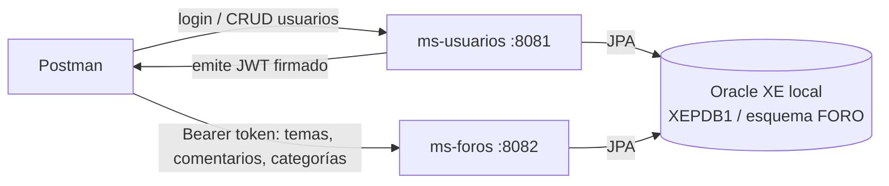
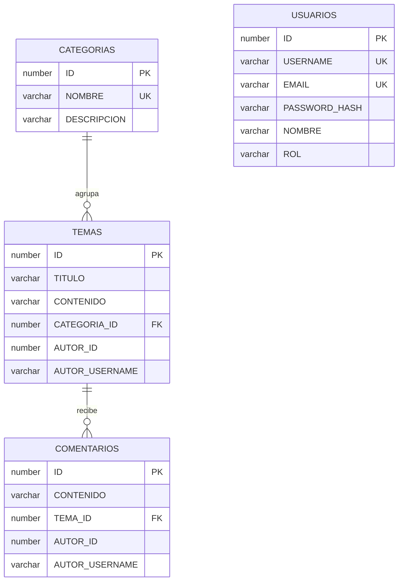

# Sistema de Foros en Línea – Backend

Actividad sumativa «Programando nuestro BackEnd» (DSY2205, Experiencia 1, semana 2).

Son dos microservicios Spring Boot conectados a **Oracle XE local**, sin FrontEnd. De los tres microservicios del caso, se construyen estos dos:

| Microservicio | Puerto | Responsabilidad | Tablas |
|---|---|---|---|
| `ms-usuarios` | 8081 | Crear, modificar y eliminar usuarios; inicio de sesión | `USUARIOS` |
| `ms-foros` | 8082 | Buscar, ver, publicar y comentar temas; categorías | `CATEGORIAS`, `TEMAS`, `COMENTARIOS` |

## Arquitectura



- **Capas** (según la guía): `controller` → `service` (interfaz e `Impl`) → `repository` (JPA) → `model`, más `dto`, `exception` y `security`.
- **Sesión:** `ms-usuarios` valida la clave (BCrypt) y entrega un JWT con el id y el rol. `ms-foros` verifica ese token con la clave compartida, sin llamar a `ms-usuarios`, así que cada servicio funciona por separado.
- **Datos:** cada tabla pertenece a un solo microservicio. `TEMAS` y `COMENTARIOS` guardan el autor (`AUTOR_ID`, `AUTOR_USERNAME`) sin clave foránea hacia `USUARIOS`, de modo que una publicación se conserva aunque su autor elimine la cuenta.
- **Buenas prácticas de la semana 2:** validación con anotaciones, `@RestControllerAdvice` con errores JSON uniformes, Spring Security, CORS con `@CrossOrigin` y logging con `@Slf4j`.



## Roles

| Acción | Sin sesión | `USUARIO` | `ADMIN` |
|---|---|---|---|
| Registrarse e iniciar sesión | Sí | Sí | Sí |
| Buscar y leer temas, comentarios y categorías | Sí | Sí | Sí |
| Publicar temas y comentar | No | Sí | Sí |
| Modificar o eliminar temas y comentarios | No | Solo los propios | Todos |
| Crear, modificar o eliminar categorías | No | No | Sí |
| Ver, modificar o eliminar una cuenta | No | Solo la propia | Todas |
| Listar usuarios, crear usuarios con rol, cambiar roles | No | No | Sí |

El registro público siempre crea rol `USUARIO`, y el sistema no permite quitar al único administrador.

## Puesta en marcha

Requisitos: JDK 21, Maven y Oracle XE con el servicio `XEPDB1`. Los comandos se ejecutan desde la raíz del proyecto.

**1. Iniciar Oracle.** Si el listener está detenido, en una PowerShell como administrador:

```powershell
Start-Service OracleOraDB21Home1TNSListener
```

**2. Crear la base de datos (solo la primera vez).** `NLS_LANG` hace que SQL*Plus guarde bien los acentos:

```powershell
$env:NLS_LANG = ".AL32UTF8"
sqlplus / as sysdba "@database/01_crear_usuario.sql"
sqlplus FORO/foro_local_2026@//localhost:1521/XEPDB1 "@database/02_esquema_y_datos.sql"
```

Al terminar el segundo script, SQL*Plus queda abierto: escribe `exit` para salir. Ese script se puede repetir para dejar los datos como al inicio. También se puede abrir en SQL Developer conectado como `FORO`.

**3. Levantar cada microservicio en su propia terminal:**

```powershell
mvn -f ms-usuarios/pom.xml spring-boot:run
```

```powershell
mvn -f ms-foros/pom.xml spring-boot:run
```

**4. Probar con Postman.** Importar `postman/Foro-en-linea.postman_collection.json` y ejecutarla con el Collection Runner o request por request, en orden. El login guarda los tokens y los POST guardan los id automáticamente. La carpeta final elimina lo creado durante la prueba.

Las pruebas automáticas no necesitan Oracle (usan H2 en memoria):

```powershell
mvn test
```

### Datos de prueba

La clave de todos es `Foro2026!`.

| Usuario | Rol |
|---|---|
| `admin` | ADMIN |
| `camila.rojas` | USUARIO |
| `diego.soto` | USUARIO |
| `valentina.diaz` | USUARIO |

Categorías cargadas: Tecnología, Videojuegos, Deportes, Cine y Series, Música. El script también carga 6 temas y 6 comentarios.

### Configuración

Cada valor tiene un valor por defecto para desarrollo local y se puede cambiar con una variable de entorno: `DB_HOST`, `DB_PORT`, `DB_SERVICE`, `DB_USER`, `DB_PASSWORD`, `JWT_SECRET` y `CORS_ORIGEN`. `JWT_SECRET` debe ser igual en ambos servicios. Las claves incluidas sirven solo para esta entrega local y no deben usarse en producción.

### Problemas frecuentes

| Síntoma | Causa | Solución |
|---|---|---|
| `ORA-12541` o `TNS: no listener` | Listener detenido | Paso 1 |
| `ORA-12514` con el listener activo | La base de datos no se registró en el listener | `sqlplus / as sysdba "@database/utilitario_registrar_listener.sql"` |
| El servicio no arranca: falta una tabla | No se ejecutaron los scripts | Paso 2 |
| 401 en Postman | Token vencido (dura 60 minutos) | Repetir los login |

## Endpoints

Todas las respuestas son JSON, incluidos los errores.

### ms-usuarios (`http://localhost:8081`)

| Método | Ruta | Acceso | Descripción |
|---|---|---|---|
| POST | `/api/auth/registro` | Público | Crea una cuenta con rol `USUARIO` |
| POST | `/api/auth/login` | Público | Devuelve el token JWT |
| GET | `/api/usuarios?q=&rol=` | ADMIN | Lista y busca por texto y rol |
| GET | `/api/usuarios/{id}` | Titular o ADMIN | Obtiene una cuenta |
| POST | `/api/usuarios` | ADMIN | Crea un usuario con cualquier rol |
| PUT | `/api/usuarios/{id}` | Titular o ADMIN | Modifica correo, nombre, clave; el rol solo ADMIN |
| DELETE | `/api/usuarios/{id}` | Titular o ADMIN | Elimina la cuenta |

### ms-foros (`http://localhost:8082`)

| Método | Ruta | Acceso | Descripción |
|---|---|---|---|
| GET | `/api/categorias` | Público | Lista con el total de temas de cada una |
| GET | `/api/categorias/{id}` | Público | Obtiene una categoría |
| POST | `/api/categorias` | ADMIN | Crea una categoría |
| PUT | `/api/categorias/{id}` | ADMIN | Modifica una categoría |
| DELETE | `/api/categorias/{id}` | ADMIN | Elimina si no tiene temas (si tiene: 409) |
| GET | `/api/temas?q=&categoriaId=&autorId=&page=&size=` | Público | Búsqueda combinable y paginada |
| GET | `/api/temas/{id}` | Público | Detalle del tema con sus comentarios |
| POST | `/api/temas` | Con sesión | Publica un tema; el autor sale del token |
| PUT | `/api/temas/{id}` | Autor o ADMIN | Modifica un tema |
| DELETE | `/api/temas/{id}` | Autor o ADMIN | Elimina el tema y sus comentarios |
| GET | `/api/temas/{id}/comentarios` | Público | Comentarios del tema |
| POST | `/api/temas/{id}/comentarios` | Con sesión | Comenta un tema |
| GET | `/api/comentarios/{id}` | Público | Obtiene un comentario |
| PUT | `/api/comentarios/{id}` | Autor o ADMIN | Modifica un comentario |
| DELETE | `/api/comentarios/{id}` | Autor o ADMIN | Elimina un comentario |

Códigos usados: 200, 201, 204, 400 (datos inválidos), 401 (sin sesión o credenciales incorrectas), 403 (sin permiso), 404 (no existe) y 409 (conflicto).

## Limitaciones conocidas

- El token sigue siendo válido hasta que vence (60 minutos), aunque en ese lapso se elimine la cuenta o cambie su rol, porque `ms-foros` no consulta a `ms-usuarios`.
- El microservicio de moderación (banear temas o comentarios) no se construye, porque la actividad pide 2 de los 3. Por ahora `ADMIN` puede editar o eliminar cualquier publicación desde `ms-foros`.
- No hay FrontEnd, según lo indicado en la actividad.
